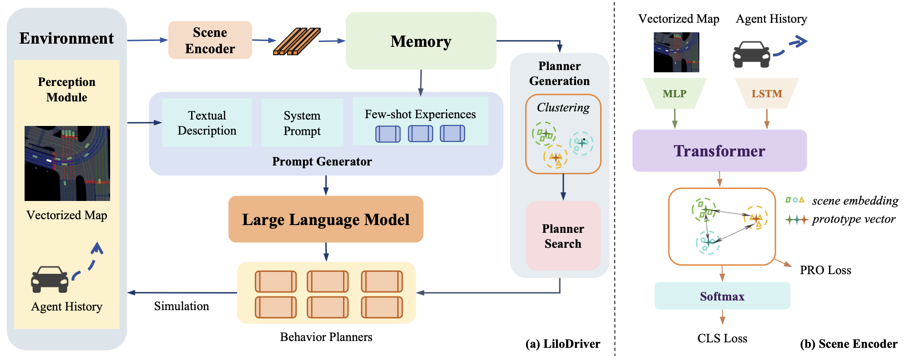
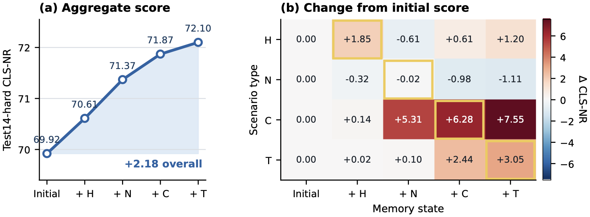

# LiloDriver: Continually Adapting Closed-Loop Motion Planners for Autonomous Driving via a Memory-Augmented LLM Agent

This repository contains the code for **LiloDriver**, a memory-augmented LLM agent that adapts a closed-loop motion planner to new scenario types without updating network parameters. It accompanies an anonymous submission.

<p align="center">
  
</p>

## Overview

LiloDriver has four components:

1. **Environment and Perception.** Builds vectorized scene inputs from nuPlan's ground-truth map and tracks: lanes (40×50×7, including traffic-light state), crosswalks (5×30×3), route lanes (10×50×3), and the 2 s history of up to 20 road agents (11 attributes each), all in the ego frame.
2. **Scene Encoder.** LSTMs encode agent histories, MLPs with max-pooling encode map polylines, and a Transformer encoder fuses the tokens. The contextualized ego token is the scene embedding *z*. The encoder is trained once on ten common scenario types using a prototype-based margin loss plus a classification loss, and is then frozen.
3. **Memory and Planner Generation.** Embeddings of training-split scenarios are stored in an external memory and clustered with DBSCAN under cosine distance. Each cluster gets the PDM-Closed configuration θ = (lo, s0, a_m, b, th) with the highest mean closed-loop score in a grid search over 162 configurations. DBSCAN noise points use a fixed fallback configuration.
4. **Reasoning and Execution.** Every 15 s the current scene is embedded and the K_r = 3 nearest memory entries are retrieved. Their clusters' configurations become the candidate set. An LLM (LLaMA-7B, greedy decoding) receives a text description of the scene plus the retrieved examples and chooses a candidate. The chosen configuration then drives a PDM-Closed planner at 10 Hz.

**Continual adaptation.** To add a new scenario type, its training-split scenarios are embedded with the frozen encoder and added to memory. DBSCAN is then re-run, and the planner search is repeated only for clusters that are new or whose membership changed by more than 10%. No network parameters are updated.

## Repository structure

```text
LiloDriver/
├── GameFormer/                          # Scene Encoder (encoder backbone adapted from GameFormer)
│   ├── GameFormer/predictor.py          #   ClassFormer: scene encoder + prototypes + classifier
│   ├── GameFormer/train_utils.py        #   stage-0 types / added types, datasets
│   ├── data_process.py                  #   nuPlan scenarios -> vectorized npz files
│   ├── train_prototype.py               #   encoder training (L = L_PRO + λ L_CLS)
│   └── agentGF.py                       #   encoder service used during simulation (shared memory)
├── llama_server.py                      # LLM server (LLaMA-7B, greedy, ≤256 new tokens)
├── tuplan_garage/                       # planners on top of tuPlan Garage (PDM-Closed)
│   ├── grid_search.py                   #   closed-loop search over the 162 configurations
│   ├── scripts/memory_pipeline.sh       #   staged memory construction (stage 0 + H, N, C, T)
│   ├── scripts/simulation/llm_sim.sh    #   closed-loop evaluation and ablations
│   └── tuplan_garage/planning/simulation/planner/
│       ├── llm_planner.py               #   LiloDriver planner (retrieval + selection + execution)
│       ├── driving_memory.py            #   memory, DBSCAN re-clustering, planner search
│       ├── lilo_configs.py              #   configuration grid Θ, fallback, PDM-Closed executor
│       └── prompt_generator.py          #   template-based scene description and prompt
└── assets/
```

## Installation

```bash
conda create -n lilodriver python=3.9
conda activate lilodriver

# nuPlan devkit v1.2.2
git clone https://github.com/motional/nuplan-devkit.git
cd nuplan-devkit && git checkout nuplan-devkit-v1.2.2 && pip install -e . && pip install -r requirements_torch.txt && cd ..

# this repository
git clone <this repository> LiloDriver
cd LiloDriver
pip install -e tuplan_garage
pip install -r requirements.txt
```

Follow the [nuPlan instructions](https://nuplan-devkit.readthedocs.io/en/latest/dataset_setup.html) to download the dataset and maps, then set:

```bash
export NUPLAN_DATA_ROOT=/path/to/nuplan/dataset
export NUPLAN_MAPS_ROOT=/path/to/nuplan/dataset/maps
export NUPLAN_EXP_ROOT=/path/to/nuplan/exp
export NUPLAN_DEVKIT_ROOT=/path/to/nuplan-devkit
```

If your database files are stored under `nuplan-v1.1/splits/<split>`, either point `data_root` in the devkit configs `scenario_builder/nuplan.yaml` and `nuplan_challenge.yaml` to that directory, or pass `scenario_builder.data_root=...` on the command line.

## Usage

### 1. Preprocess training-split scenarios

```bash
cd GameFormer
python data_process.py \
    --data_path $NUPLAN_DATA_ROOT/nuplan-v1.1/splits/trainval \
    --map_path $NUPLAN_MAPS_ROOT \
    --scenario_filter ../tuplan_garage/tuplan_garage/planning/script/config/common/scenario_filter/train14_10k.yaml \
    --save_path /path/to/processed/train
```

This step writes one `<map>_<token>.npz` file per scenario plus `scenario_types.json`, which maps each token to its type.

### 2. Train the Scene Encoder (stage 0)

```bash
python train_prototype.py \
    --train_dir /path/to/processed/train \
    --type_json /path/to/processed/train/scenario_types.json \
    --name scene_encoder_stage0
```

The defaults follow the paper: 12,000 scenarios from ten common types, a 3-layer / 8-head Transformer, d = 256, m_p / m_n = 0.1 / 0.5, λ = 0.5, AdamW with lr 1e-4, 30 epochs, and batch size 64. The encoder is not trained again after this step.

### 3. Build the memory in stages

```bash
cd ../tuplan_garage
export LILO_MEMORY_PATH=/path/to/memory
NPZ_DIR=/path/to/processed/train \
TYPE_JSON=/path/to/processed/train/scenario_types.json \
ENCODER_CKPT=../GameFormer/ckpt/scene_encoder_stage0/model_epoch_30.pth \
bash scripts/memory_pipeline.sh
```

Stage 0 adds the ten common types. Stages 1–4 then add *high magnitude speed* (H), *near multiple vehicles* (N), *changing lane* (C), and *traversing pickup/dropoff* (T), in that order. Each stage runs the following steps:

| Step | Command | What it does |
|---|---|---|
| add | `driving_memory.py add` | embed D_t, insert, re-run DBSCAN (ε = 0.15, minPts = 5), mark new or >10%-changed clusters |
| pending | `driving_memory.py pending` | list the training scenarios of the marked clusters |
| grid search | `grid_search.py` | non-reactive closed-loop simulation of all 162 configurations on those scenarios |
| search | `driving_memory.py search` | θ\*\_k = argmax_θ mean score over cluster C_k |

After stage *t*, a snapshot of the memory is saved to `${LILO_MEMORY_PATH}_stage<t>`. Set `LAST_STAGE` to stop the pipeline early.

Configuration grid Θ (2 × 3⁴ = 162):

| Parameter | Values |
|---|---|
| lateral offsets lo | {0} or {−1, 0, 1} m |
| minimum gap s0 | {1, 2, 3} m |
| max. acceleration a_m | {1.0, 1.5, 2.0} m/s² |
| comfortable deceleration b | {2, 3, 4} m/s² |
| TTC threshold th | {1, 2, 3} s |
| IDM T_hw / δ (fixed) | 1.5 s / 4 |

### 4. Closed-loop evaluation

Start the two services, then run the simulation:

```bash
# Scene Encoder service
cd GameFormer && python agentGF.py --ckpt ckpt/scene_encoder_stage0/model_epoch_30.pth &
# LLM server (LLaMA-7B; use --model to point to local weights)
python llama_server.py --model /path/to/llama-7b &

# simulation (non-reactive closed-loop score)
cd tuplan_garage
LILO_MEMORY_PATH=/path/to/memory_stage4 SPLIT=test14-hard bash scripts/simulation/llm_sim.sh
```

Supported splits are `val14_split` and `test14-hard`. To reproduce the incremental results (Table 2), evaluate each snapshot `memory_stage0` through `memory_stage4`. The paper reports the mean of three runs.

### Ablations (Table 3)

| Setting | Command |
|---|---|
| Non-LLM selector: same memory, neighbors, and candidates; greedy on the stored cluster score | `SELECTOR=greedy bash scripts/simulation/llm_sim.sh` |
| No memory, fixed fallback configuration | `SELECTOR=none bash scripts/simulation/llm_sim.sh` |
| No Scene Encoder: flattened perception features (memory must be built with `EMBEDDING=flat`) | `EMBEDDING=flat bash scripts/simulation/llm_sim.sh` |

## Results

Non-reactive closed-loop score (CLS-NR) on nuPlan, mean of three runs, as reported in the paper:

| Planner | Val14 | Test14-hard |
|---|---|---|
| PDM-Closed | 92.84 | 65.07 |
| PlanTF | 84.83 | 72.68 |
| LLM-Assist (PAR) | 93.05 | – |
| PlanAgent | 93.26 | 72.51 |
| LiloDriver (initial memory) | 93.09 | 69.92 |
| LiloDriver (after 4 memory updates) | **93.33** | 72.10 |

<p align="center">
  
</p>

## Limitations

- Memory updates are curated offline from labeled training-split scenarios and require closed-loop simulation for the planner search. LiloDriver does not learn online while driving.
- With T_LLM = 15 s, the LLM selects a configuration once per nuPlan scenario.
- All experiments use nuPlan simulation with ground-truth perception.

## Acknowledgements

This code builds on [nuPlan devkit](https://github.com/motional/nuplan-devkit), [tuPlan Garage](https://github.com/autonomousvision/tuplan_garage) (PDM-Closed), [GameFormer](https://github.com/MCZhi/GameFormer-Planner) (encoder backbone and feature processing), and [LLaMA](https://github.com/facebookresearch/llama). Their licenses apply to the corresponding code.
